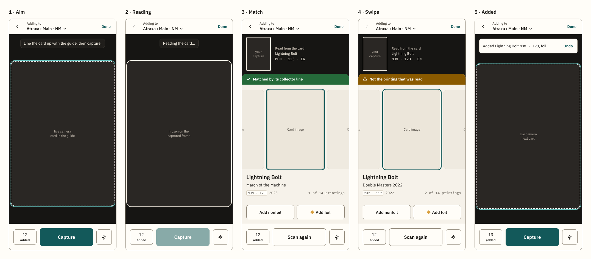
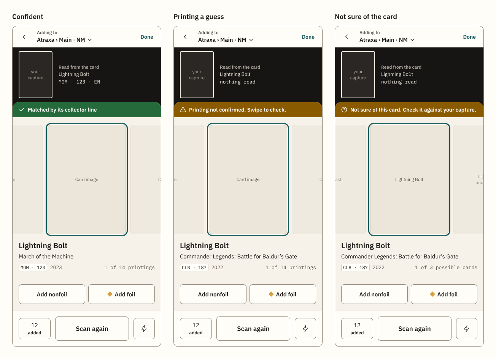

# Scanner: a phone-first layout and selection flow

**Date:** 2026-11-12. **Status:** draft, awaiting the maintainer's approval. Nothing is filed yet.
**Builds on:** the scanner as built (specs 007, 009, 011, 040, 042, 047; [`docs/architecture/scanner.md`](../../architecture/scanner.md); [`Scanner.md`](../../design-system/components/Scanner.md)), read against `main` at `100c961`, and an interview with mock-ups on 2026-11-12.
**Mock-ups:** in [`2026-11-12-scanner-phone-first-mockups/`](2026-11-12-scanner-phone-first-mockups/), drawn at 390 × 844 with placeholder card images: `scanner-flow.png` (the five steps), `scanner-confidence.png` (the pane's three states), `scanner-shell.png` and `scanner-pane.png` (the same screens, cut per issue). The working canvas, with the three layouts that were compared, is the maintainer's private artifact <https://claude.ai/artifact/SPaiks4wPGq48UkmDRvV9Q>.
**Deliverable:** design-system changes and GitHub issues that Claude Code agents can each take through the SDD workflow as one outcome in one PR, design-system issue first (as the decks design of 2026-11-09 did).

## Why

The scanner is one scrolling column: status, a 3:4 camera stage, the controls, "What the scanner read", a grid of candidates, then the sitting panel with its Condition and Location form. On a phone the candidates land below the camera, so every card is capture, scroll down, add, scroll back up. Spec 009 measured a median of 23 s per card.

How the maintainer scans (interview, 2026-11-12):

- Decks, boxes and binders are separate sittings. A deck is scanned all at once; a binder or box is added to in several visits. Cards bound for different places are rarely mixed in one sitting.
- When the scanner gets the card right, the only thing left to do is say foil or nonfoil.
- Picking another printing "was always tricky", and should be a swipe through the options.

So the destination belongs to the sitting, not to each card, and the per-card flow is: capture, glance, one tap on a finish, or a swipe first when the printing is wrong.

## Decisions

Each is the maintainer's unless it is marked *(my call)*.

### The page

1. **The capture button is always in view while the camera is open.** The page is one screen high and never scrolls: a top bar, the camera, a bottom bar.
2. **The camera view is as large as possible.** With no result showing it fills everything between the two bars. On a 390 × 844 phone the guide grows to about 380 × 536 px (today about 300 × 416).
3. **The scanner is a focused page** *(my call)*: no app header and no tab bar (`c-shell--untabbed` exists). The top bar holds a back arrow, the sitting's destination and "Done".
4. **The destination is in the top bar.** It reads "Adding to" with the place and the short condition ("Atraxa › Main · NM"), or "No location" and no condition when unset, and opens a sheet with the sitting's choices. Today's "This sitting's cards" form at the foot of the page goes. A sitting already stays open across visits until Done, so coming back to a binder resumes it with its destination showing.
5. **The bottom bar** *(my call)* holds, left to right: the sitting's count ("12 added", which opens the sitting's list as a sheet), the capture button, and the torch (only where the camera reports one).
6. **Sheets keep the camera running** *(my call)*. The destination and the sitting's list open over the page, because every visit to the scanner is a full page load that releases the camera (`turbo-visit-control: reload`). "Done" still goes to its `ConfirmPage`, and "Details" of an add still leaves for Edit copy: both end the scanning anyway.

### The capture flow

7. **Aim.** Live camera with the guide. A status line sits over the top of the camera ("Line the card up with the guide, then capture.").
8. **Reading.** On capture the view freezes on the captured frame and the status says "Reading the card…". The capture button is disabled while a reading runs, as today.
9. **Match.** The frozen capture shrinks into a strip at the top (the picture, and beside it the name and collector line read from it) and the selection pane slides up from the bottom bar. The capture stays visible beside the candidates so a printing is checked by eye.
10. **Swipe.** The pane holds a row of card images, the best match centred with its neighbours showing at the sides. A swipe moves to another printing.
11. **Add.** One button per finish under the row ("Add nonfoil", "Add foil"; a single "Add" for one finish or none), applying to the centred card. After an add the pane drops, the camera is live at full size, and a line over the camera confirms it with Undo ("Added Lightning Bolt MOM · 123, foil"). The count in the bottom bar goes up.
12. **While a result shows, the main button reads "Scan again"** *(my call)*: same place, same size, secondary style. It discards the reading and returns to the live camera. The usual rhythm is Capture, Add foil, Capture.

### The selection pane

13. **A status band forms the pane's top edge and shows confidence**, filled with a status colour, always with an icon and words:

    | State | Colour, icon | Words |
    |---|---|---|
    | Card and printing matched | success, check | the evidence, as today's badge: "Matched by its collector line", "…, one digit corrected", "Matched by its artwork" |
    | Card right, printing a guess | warning, alert | "Printing not confirmed. Swipe to check." |
    | Not sure of the card | warning, question mark | "Not sure of this card. Check it against your capture." |

    Two colours, not three *(my call, accepted with the mock-ups)*: `danger` stays for errors, and the icon and words tell the two lower states apart.
14. **The band follows the swipe** *(my call)*: on a printing other than the matched one it reads "Not the printing that was read", in warning.
15. **One details block under the row describes the centred card**, each fact on its own line: the card's name; the set's full name, free to wrap; then the set code and number with the release year on the left and the position ("1 of 14 printings") on the right. The images carry no text. (Chosen over details under each image, which truncated set names.)
16. **Sizes at 390 × 844:** capture strip 144 px high with a 124 px picture; images 206 px wide (about 288 px high), about 80 px of each neighbour showing.
17. **What the row holds** *(my call)*: the candidates first (at most three, in ranked order), then the centred card's other printings in today's Other printings order (shared artwork, read set and number, read set, read number, the rest; newest first). When the scanner is not sure of the card, the row holds the candidate cards and reads "1 of 3 possible cards"; choosing a card's other printings reloads the row for that card.
18. **"What the scanner read" leaves the main flow** *(my call)*. The name and collector line show beside the capture; the parsed set, number, language and the Printing and Artwork outcomes are no longer shown to the collector (measurement mode keeps recording them).
19. **Swiping is never the only way** *(my call)*: "Previous" and "Next" buttons move the row for keyboards, switch access and fine pointers, and the centred card is announced through the live region.

### Later version: look up

20. **Look-up is a second mode on the same layout** (#262): the top bar reads "Looking up" with no destination and no count, and the pane's add buttons give way to the card's page link and what is owned ("You own 3 · 1 free to use"). It is drawn and specified with #262, after the add flow ships.

## What it changes in the design system

- **README, Mobile and Hotwire:** a rule for focused pages (a task page may drop the header and tab bar when it keeps a back arrow and its own primary action in view); a rule for sheets; a rule that a swipe always has a button equivalent.
- **README, Color:** status colours gain a filled use, the status band, with new tokens for the text on it, `on-success` and `on-warning`, in both themes (the dark theme's `success` and `warning` are light, so white text fails on them). Still never colour alone.
- **`Scanner.md`:** rewritten for the new markup: the shell, the status line over the camera, the frozen capture strip, the selection pane, the after-add line, the bottom bar. The copy of every state.
- **New component docs:** `Sheet` (a bottom sheet over a page: the destination and the sitting's list are its first two uses) and `StatusBand` *(my call on both names)*.
- **Previews** in `docs/design-system/previews/`: the five steps and the three confidence states at 390 px, light and dark, built from the mock-ups with the real CSS.
- **Motion:** the shrink and the slide take at most 200 ms and are instant under `prefers-reduced-motion`.

## Constraints found in the code

- **The guide's geometry is measured.** The stage is 3:4 and the guide 80% of its height; `scanner/geometry.js` holds the same numbers, and the settings and accuracy of specs 007, 009 and 011 were measured at that framing. A full-height stage changes the crop, so the build re-measures the reading on live captures before it ships. Check that the cards are at hand before the spec asks for it.
- **Capture and add stay the collector's taps** (spec 007 FR-2, spec 009 FR-1), and one reading still adds at most one copy (the reading key).
- **The picture never leaves the device.** The frozen frame and the capture strip are drawn in the page from the captured frame; nothing new is sent.
- **Only scanner pages send the Content-Security-Policy.** The pane's images come from the hosts candidates' images come from today.
- **The sitting's files name no collectible** (`spec/scanner_sitting_core_spec.rb`); finish names keep coming from the collecting vocabulary.
- **Redraws are announced and focus is managed** (spec 047). The status line, the band and the after-add line are live regions; opening a sheet moves focus into it and closing returns it to the control that opened it.
- **Touch targets are 44 px with no exception** (spec 075).
- **Hotwire first.** The row is native horizontal scrolling with scroll snap; further printings arrive in a Turbo Frame; the server renders every card's details and add buttons. A small Stimulus controller only notes which card is centred. No client-side state store.

## Goals, non-goals, anti-goals

**Goals**
- Capture always in view; the largest camera view the screen allows.
- A confident match is added with one tap after the capture.
- Another printing is reached by swiping, compared against the capture.
- Lower confidence is visible at a glance, in words as well as colour.
- The destination is set once and is always visible.

**Non-goals**
- Continuous or hands-free capture (#54), detection on live frames (#53), Japanese cards (#55), a sitting's language (#58, which only gains its place in the destination sheet).
- Any change to how a card is read or ranked, beyond the guide's size.
- A native app.

**Anti-goals**
- A layout that scrolls the capture button away.
- A result that hides which printing is about to be added.
- A gesture with no button equivalent.
- A second, different scanner for look-up.

## The issues

New issues carry `theme: scanner`, use the roadmap's issue format (an **Outcome** line, bullets, the standard footer) and list their dependencies. Milestone: 1.0 proposed for [1]–[3] *(my call; the maintainer places them)*. Numbers in brackets are this document's order.

**[1] Design system: the phone-first scanner.** Labels `design-system`, `theme: scanner`. The README rules, `Scanner.md`, `Sheet`, `StatusBand`, the tokens, the `additions.css` rules and the previews listed above. The mock-ups are the starting point.

**[2] Scanner: capture always in view.** Depends on [1]. The one-screen page: top bar with the destination, full-height camera, bottom bar; the destination and the sitting's list as sheets (the existing form and list, moved); no tab bar. A result opens in the pane's place with today's candidates inside it, scrolling within the pane. Includes the guide's new geometry and its re-measure.

**[3] Scanner: the selection pane.** Depends on [2]. Freeze, shrink and slide; the status band; the swipe row with Previous and Next; the details block; add per finish; the after-add line with Undo; "Scan again". Supersedes the candidates grid, "What the scanner read" on the page and the Other printings frame of spec 009.

**Existing issues to change**

- **#262 (add and look-up modes):** rewrite on this layout (decision 20); depends on [3]. Its milestone stays the maintainer's to place.
- **#58 (a sitting's language):** the language is a third field of the destination sheet; depends on [2].
- **#54 (continuous capture):** add that the trigger replaces the tap on the capture button within this layout, that the after-add line with Undo is what catches a wrong automatic add, and that it depends on [3].
- **#53 (detection on live frames):** add that the 0.596 card-to-frame figure was measured on the 3:4 stage and is measured again on the full-height stage of [2].
- **#52, #55:** unchanged.

**Roadmap.** Theme D gains [1]–[3] ahead of the spikes' build specs, and the line "The scanner as built stays as it is until this theme" is amended.

## Left to each issue's spec

- The sheets' markup (`<dialog>` or another element) and how they behave without the camera (no HTTPS, permission denied), where the photo picker is the only way in.
- Where "Use a photo", the artwork-matching status line and the photo-framing hint sit *(my suggestion: "Use a photo" over a corner of the live camera, the two lines in the destination sheet's foot)*.
- Where "Nothing could be read", "No card matches", the catalog-not-ready notice and the send failures ("Send again", "Sign in") show *(my suggestion: back on the live camera's status line for the first two, in the pane for the rest)*.
- The layout from 640 px up *(my suggestion: the same column, centred, 480 px wide at most)*.
- Landscape, and the safe-area insets of phones with a home indicator.
- How many printings load at once, and what replaces "Show N more".
- The exact tokens for text on the band, checked for contrast in both themes.
